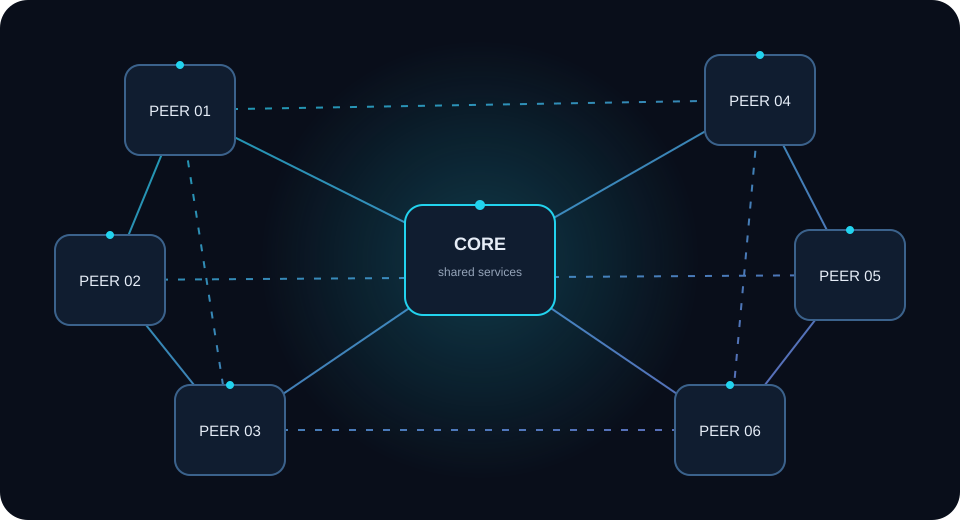
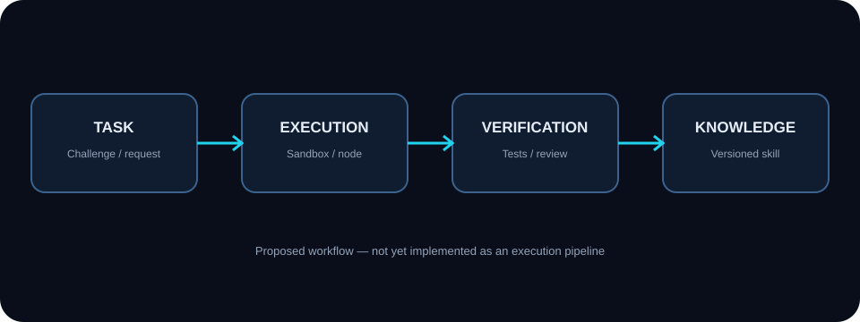
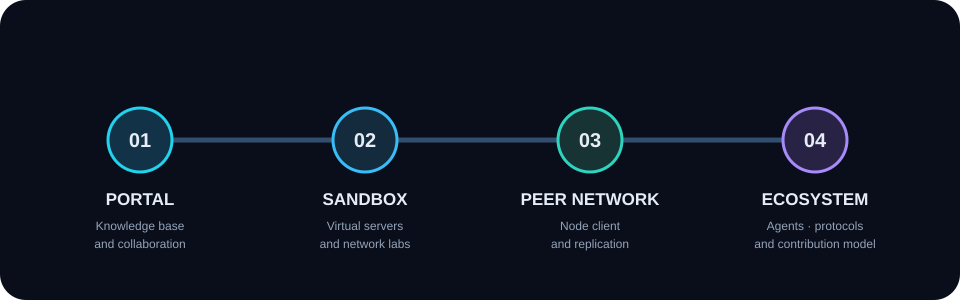

# NETWORK CORE

### Открытая лаборатория распределённой инфраструктуры

**Исследуем. Проектируем. Проверяем. Собираем сеть вместе.**

[Концепция](#концепция) · [Архитектура](#архитектура) · [Текущий статус](#текущий-статус) · [Дорожная карта](#дорожная-карта) · [Участие](#участие)

---

> **Ncore начинается с нуля.** Это первый день публичной разработки: описание, архитектура и приоритеты будут меняться по мере исследований, экспериментов и обратной связи. README фиксирует текущее направление, а не обещает уже существующие функции.

## Концепция

**NETWORK CORE (Ncore)** — проектируемая технологическая экосистема на стыке сетевой инженерии, виртуальных лабораторий, коллективной базы знаний и ИИ-инструментов.

Идея — создать среду, в которой участники смогут собирать виртуальные серверы, экспериментировать с сетевыми протоколами, решать инженерные задачи, проверять результаты и превращать удачные решения в повторно используемые знания.

Долгосрочная цель — постепенно перейти от информационного портала к рабочим лабораториям, затем к добровольной сети узлов и сервисам поверх неё. Каждый этап должен иметь измеримые критерии готовности и отдельную модель безопасности.

## Основные направления

| Направление | Назначение |
|---|---|
| **Network Lab** | Виртуальные серверы, узлы, адресация, маршрутизация и сетевые эксперименты |
| **Protocol Workshop** | Изучение, прототипирование и тестирование протоколов и механизмов защиты |
| **Knowledge Core** | База проверенных решений, документации, тестов и версионируемых навыков |
| **AI Agents** | В перспективе — агенты для диагностики, анализа, выполнения разрешённых задач и работы со знаниями |
| **Peer Network** | Исследование добровольной P2P-сети, репликации и обмена артефактами |
| **Contribution Economy** | Прозрачный учёт полезного вклада; экономическая модель будет проектироваться отдельно |

## Архитектура

Архитектура ниже — **целевая концептуальная модель**, а не описание уже развернутой распределённой сети.

### Топология узлов

Участники, лабораторные среды и общие сервисы в перспективе образуют связанную систему. Конкретная топология, доверие между узлами, обнаружение peers и механизмы репликации требуют отдельного проектирования и испытаний.

### Слои системы

### Поток инженерной задачи

Предлагаемый цикл: постановка задачи → изолированное выполнение → проверка → публикация воспроизводимого результата в базе знаний.

## Текущий статус

Состояние на начало публичной разработки. Статус будет обновляться вместе с кодом.

| Подсистема | Статус |
|---|---|
| Информационный портал | Реализован базовый интерфейс |
| Авторизация и пользовательские материалы | Подключены Firebase Auth и Firestore |
| Публикации, комментарии, глоссарий | Есть базовая функциональность |
| Дорожная карта и справочники | Есть базовая функциональность |
| Интерактивные схемы | Есть SVG-визуализации |
| Исполняемая сетевая песочница | Не реализована |
| Игровой магазин и сборщик VPS | Есть прототип: покупка комплектующих, склад и сборка конфигурации |
| Запуск реальных ОС и сетевых служб на VPS | Не реализован |
| P2P-узлы и репликация | Не реализованы |
| Рабочие ИИ-агенты | Не реализованы |
| Собственные протоколы Ncore | Не реализованы |
| COIN и реальные выплаты | Не реализованы; экономическая концепция требует отдельной проработки |

**Важно:** игровой прототип пока не запускает виртуальные машины и сетевые службы. Баланс COIN тестовый, а прогресс хранится локально в браузере отдельно для каждого аккаунта; серверной синхронизации и реальных платежей нет. Наличие схемы, описания или пункта в дорожной карте не означает, что соответствующий сервис уже работает.

## Дорожная карта

Переход между этапами должен определяться результатами тестирования, а не только датами.

1. **Portal Core** — документация, база знаний, обсуждения, управление концепцией.
2. **Network Sandbox** — изолированные виртуальные узлы и воспроизводимые учебные задачи.
3. **Peer Network** — добровольный клиент узла, безопасное подключение, обмен и репликация.
4. **Agent & Protocol Ecosystem** — проверяемые навыки, ограниченные ИИ-агенты, протоколы и инструменты.
5. **Contribution Model** — прозрачная оценка вклада и только после юридической и технической проверки — возможные экономические механизмы.

## Принципы проектирования

- **Безопасность по умолчанию.** Изоляция лабораторий, минимальные привилегии, явные разрешения и аудит действий.
- **Проверяемость.** Результаты должны воспроизводиться тестами и ссылаться на версии исходников и спецификаций.
- **Постепенная децентрализация.** Не объявлять систему распределённой до появления работающих узлов, протоколов и измерений.
- **Открытая документация.** Решения, ограничения и изменения архитектуры фиксируются публично.
- **Управляемый ИИ.** Агентам предоставляются только необходимые инструменты и ограниченные полномочия; критические действия требуют контроля.
- **Честная экономика.** Никаких обещаний доходности или выплат до появления проверяемой модели, юридической оценки и работающего учёта.

## Технологическая база

Текущий портал использует:

- React 19
- TypeScript
- Vite
- Tailwind CSS 4
- Firebase Authentication
- Cloud Firestore
- SVG для схем и векторной графики

Технологии будущих сетевых и вычислительных компонентов не считаются окончательно выбранными. Решения по P2P-транспорту, идентичности узлов, хранилищу, очередям и криптографии должны приниматься после прототипирования и threat modeling.

## Участие

На раннем этапе особенно полезны:

- архитектурные предложения с описанием компромиссов;
- небольшие воспроизводимые прототипы;
- тест-кейсы и сценарии угроз;
- техническая документация и схемы;
- ревью кода и поиск ошибок;
- предложения по критериям приёмки этапов.

Для существенных изменений сначала создавайте Issue с проблемой, ожидаемым результатом и критериями проверки. Для кода — отдельная ветка и Pull Request.

## Репозиторий

- Код: [alexpikman/ncore](https://github.com/alexpikman/ncore)
- Ветка разработки: `main`
- Статус: ранняя стадия, концепция и портал развиваются параллельно.

---

**NETWORK CORE · NCORE**

*От идеи — к лаборатории. От лаборатории — к проверяемой инфраструктуре.*

